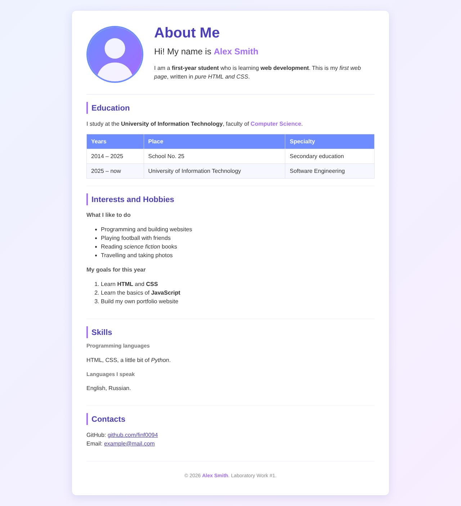
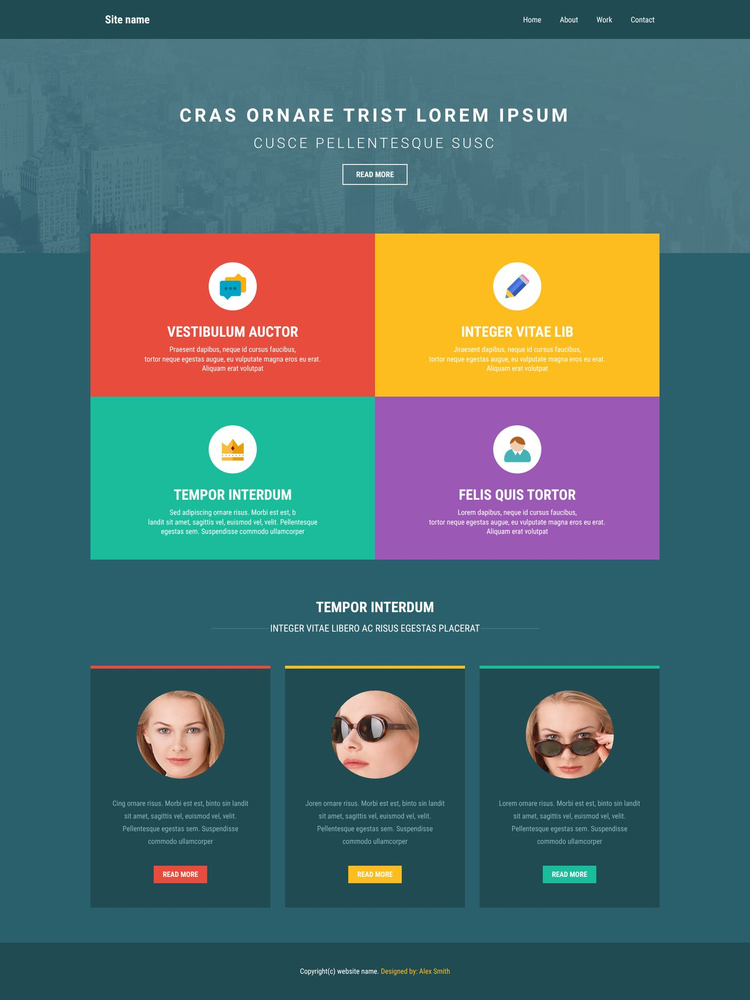
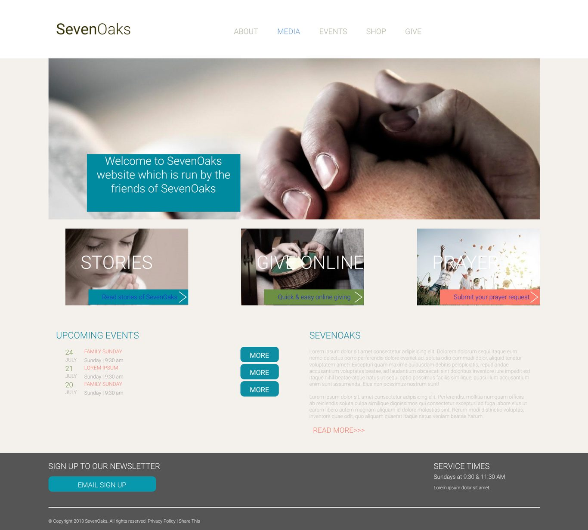
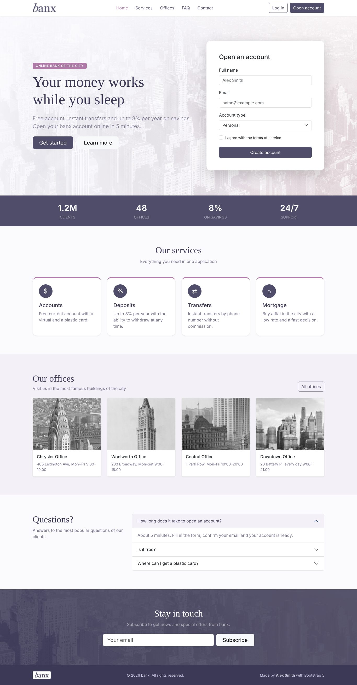
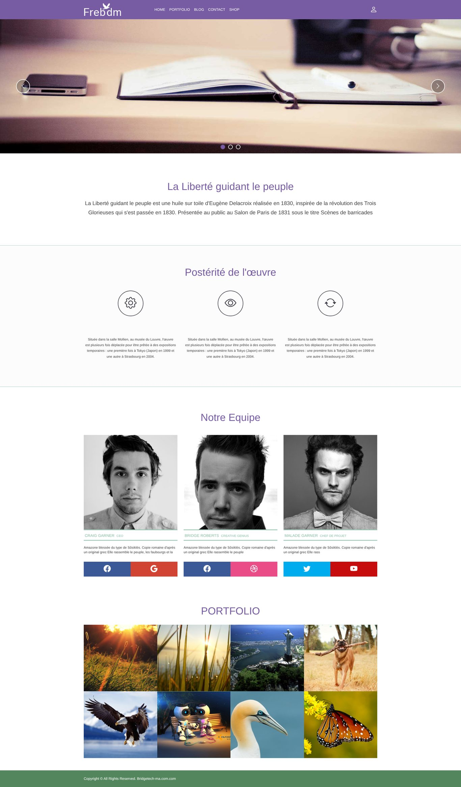

# project-research — лабораторные по веб-программированию

Каждая лабораторная лежит в отдельной папке. Лабы 1–5 — веб-страницы: откройте `index.html` в браузере. Лаба 6 — программы на Python: `python3 <файл>.py`.

| # | Папка | Задание | Технологии |
|---|-------|---------|------------|
| 1 | [`lab1-about-me`](lab1-about-me/) | Страница «About Me» | HTML, CSS |
| 2 | [`lab2-homework4-layout`](lab2-homework4-layout/) | Вёрстка по референсу `homework_4.jpg` | HTML, CSS (Flexbox), без фреймворков |
| 3 | [`lab3-sevenoaks-flexbox`](lab3-sevenoaks-flexbox/) | Вёрстка сайта SevenOaks по макету | HTML5, CSS3, Flexbox (без Grid и фреймворков) |
| 4 | [`lab4-bootstrap-banx`](lab4-bootstrap-banx/) | Страница на Bootstrap, подключённом локально из `dist/` | HTML, CSS, Bootstrap 5.3.3 (локально) |
| 5 | [`lab5-bootstrap-freedom`](lab5-bootstrap-freedom/) | Страница «Freedom»: navbar, carousel, сетка, галерея | HTML5, CSS3, Bootstrap 5 + Icons (CDN) |
| 6 | [`lab6-python-variables`](lab6-python-variables/) | Переменные, типы данных, ввод и вычисления: 10 консольных программ | Python 3 |

Лабы 1–4 работают без интернета. Лаба 5 подключает Bootstrap через CDN (так требует задание), поэтому ей нужен интернет.

В каждой папке есть `README.md` с описанием и чек-листом требований. У лаб 1–5 есть `screenshot.jpg` с результатом, у лабы 6 примеры запуска приведены прямо в README.

## Исходные материалы

Папка [`materials/`](materials/): тексты заданий (`docs/`), макеты и референсы (`lab2-reference/`, `lab3-design/`, `lab5-reference/`), присланные картинки (`images/`).

## Скриншоты

| Лаба 1 | Лаба 2 |
|---|---|
|  |  |
| **Лаба 3** | **Лаба 4** |
|  |  |
| **Лаба 5** | |
|  | |
