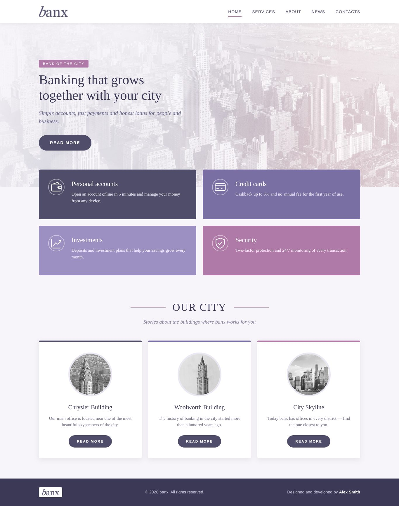

# Practical Assignment — вёрстка страницы по референсу (banx)

Лендинг банка **banx** только на HTML и CSS, без фреймворков.

**Запуск:** открыть `index.html` в браузере.

```
lab2-banx-layout/
├── index.html
├── main.css          ← подключён через <link>
└── img/              ← логотип, фон, картинки зданий, icons/*.svg
```

## Структура страницы

1. **Header**: логотип banx и горизонтальное меню из 5 пунктов.
2. **Hero**: свой фон (`background-image`), заголовок, подзаголовок, кнопка *Read More*; текст поверх картинки (`position: absolute`).
3. **Четыре инфо-блока 2×2**: у каждого свой цвет фона, есть иконка, заголовок и описание (Flexbox + `flex-wrap`).
4. **Заголовок секции**: заголовок, подзаголовок и декоративные линии (`::before` / `::after`).
5. **Три карточки** в ряд: круглое фото (`border-radius: 50%`), описание, кнопка *Read More* и цветная верхняя граница.
6. **Footer**: копирайт и автор.

## Чек-лист CSS-требований

- `.container` для основного контента
- `display: flex`, `justify-content`, `align-items`, `flex-wrap`
- `margin`, `padding`, `width`, `height`
- `background-color`, `background-image`
- `border`, `border-radius`
- `position: relative` / `position: absolute`
- псевдоэлементы `::before` и `::after` (затемнение hero, линии у заголовка, подчёркивание в меню)
- круглые картинки в карточках

> Референс `homework_4.jpg` и ZIP с иконками в материалах не было, поэтому страница сделана по требованиям задания на присланных картинках banx. Иконки нарисованы в SVG.


